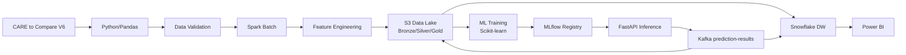
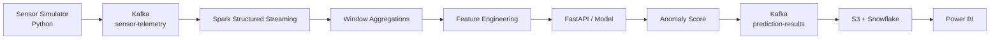

# Architecture

## 1. High-level architecture

Four domains: Data Ingestion, Data Processing & Storage, ML & MLOps,
Data Consumption & Visualization.

## 2. Streaming flow

## 3. Component responsibilities

| Component | Responsibility |
|---|---|
| Kafka | Event ingestion and transport |
| Spark | Data processing (batch + streaming) |
| Airflow | Workflow orchestration |
| S3 | Data lake storage (Medallion) |
| Snowflake | Analytics / data warehouse |
| MLflow | Experiment tracking & model registry |
| FastAPI | Inference service |
| Power BI | Visualization |

## 4. Data lake (Medallion)

- **Bronze**: raw events, minimal transformation.
- **Silver**: validated, cleaned, structured.
- **Gold**: aggregated, analytics/ML-ready (Parquet, partitioned).

## 5. Principles

- Separation of responsibilities.
- Incremental development (local first, cloud later).
- Reproducibility.
- Data quality first.
- No data leakage.
- Security (no secrets in repo).
- Observability.
- Documentation.

## 6. Decisions status

- **Confirmed**: Medallion on S3, FastAPI for inference, MLflow for tracking, Power BI for viz.
- **Provisional**: SageMaker/ECS hosting (evaluate later), Evidently for monitoring.
- **Pending**: per-farm schema equivalence, gap handling policy, labeling rule for evaluation.
